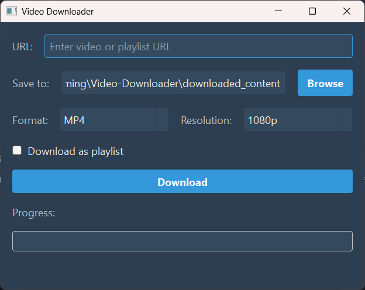

# Video Downloader

> A cross-platform desktop GUI for downloading video and audio from 1000+ sites via [yt-dlp](https://github.com/yt-dlp/yt-dlp), with a multi-threaded queue and progress tracking. Built with Python and PyQt6.

[](https://github.com/OneAutumnLeaf4700/Video-Downloader/actions/workflows/tests.yml)
[](https://github.com/OneAutumnLeaf4700/Video-Downloader/releases)
[](https://www.python.org/)
[](LICENSE)



<!-- TODO: replace banner with a 15-second GIF demo of the GUI downloading something. Save as docs/demo.gif. -->

## Features

- **Modern PyQt6 GUI** — clean dark-themed interface
- **100+ supported sites** — anything yt-dlp can grab (YouTube, Vimeo, Twitch, etc.)
- **Multi-threaded queue** — multiple downloads run in parallel with configurable worker count
- **MP4 or MP3** — download as video (single merged MP4 with resolution suffix in filename) or extract audio as MP3
- **Resolution selection** — pick max video quality (1080p, 720p, 480p, …)
- **Auto folder organisation** — files land in `<output>/mp4/` or `<output>/mp3/`
- **Open folder shortcut** — one-click button opens the current download folder
- **Real-time progress** — progress bar and queue display per task
- **Robust error handling** — playlist downloads skip individual failures and continue

## Tested platforms

- Windows 10 / 11 (primary target — prebuilt `.exe` available on the Releases page)
- macOS and Linux work from source

## Prerequisites

- **Python 3.8+** (only needed if running from source)
- **FFmpeg** on your PATH — required by yt-dlp for video/audio merging and conversion. Download from [ffmpeg.org](https://ffmpeg.org/download.html). The app will warn you on launch if it's missing.
- **An internet connection**

## Installation

### Option 1 — Prebuilt Windows executable (recommended for end users)
1. Go to the [Releases](https://github.com/OneAutumnLeaf4700/Video-Downloader/releases) page
2. Download the latest `VideoDownloader.exe`
3. Make sure `ffmpeg` is installed and on your PATH, then double-click to run

### Option 2 — From source (cross-platform)
```bash
git clone https://github.com/OneAutumnLeaf4700/Video-Downloader.git
cd Video-Downloader
python -m venv venv
source venv/bin/activate          # Windows: venv\Scripts\activate
pip install -r requirements.txt
python main.py
```

## Usage

1. **Launch the app** — you'll get a warning dialog if FFmpeg isn't detected
2. **Paste a video or playlist URL** into the URL field
3. **Pick a download location** with the *Browse* button
4. **Choose format** (MP4 or MP3) and (for MP4) a max resolution
5. **Click *Download*** — the task lands in the queue and progress is shown live; multiple downloads run in parallel
6. **Open the output folder** any time with the *Open Folder* button

Set the env var `VIDEO_DOWNLOADER_DEBUG=1` before launching to enable verbose logging.

## Legal & Intended Use

> Read this before downloading anything.

This tool is provided for **personal, lawful use only** — for example, downloading content you own, content licensed under permissive terms (Creative Commons, public domain), or content the platform explicitly allows you to save.

**You are responsible** for ensuring your use complies with:
- The Terms of Service of every site you download from (YouTube, Twitch, TikTok, and most others restrict or prohibit downloading)
- Copyright law in your jurisdiction
- Any other applicable terms attached to the content

The author of this software does not condone copyright infringement, ToS violations, or redistribution of downloaded material. See the [yt-dlp project's own legal note](https://github.com/yt-dlp/yt-dlp#disclaimer) for further context — this app is a UI on top of yt-dlp and inherits the same caveats.

## Development

### Setup
```bash
git clone https://github.com/OneAutumnLeaf4700/Video-Downloader.git
cd Video-Downloader
python -m venv venv
source venv/bin/activate
pip install -r requirements.txt
pip install -r requirements-dev.txt
```

### Run tests
```bash
pytest --cov=src --cov-report=term-missing
```

### Project layout
```
Video-Downloader/
├── main.py                          # Entry point
├── src/
│   ├── config.py
│   ├── gui/
│   │   ├── app.py                   # QApplication bootstrap, FFmpeg check
│   │   ├── main_window.py           # Main window UI
│   │   ├── worker.py                # Background worker
│   │   └── style.qss                # Qt stylesheet
│   ├── utils/
│   │   └── folder_utils.py          # Folder structure helpers
│   └── video_downloader/
│       ├── downloader.py            # yt-dlp wrapper, format building
│       └── queue_manager.py         # Multi-threaded download queue
├── tests/                           # pytest suite
├── docs/                            # Screenshots, project overview
└── .github/workflows/               # CI: tests, build/release
```

## Troubleshooting

**App warns "FFmpeg not found" on launch.** Install FFmpeg from [ffmpeg.org/download.html](https://ffmpeg.org/download.html) and ensure the `ffmpeg` binary is reachable from your shell (`which ffmpeg` / `where ffmpeg` should print a path). Restart the app.

**A download fails partway through.** Check the log output. For YouTube specifically, yt-dlp may need to be updated when YouTube changes its API: `pip install -U yt-dlp`.

**A whole playlist fails.** Make sure the playlist URL works in a browser. Private/age-restricted playlists need cookie-based auth which this app does not currently expose.

**Output folder not opening.** The *Open Folder* button uses the OS's default file manager via `xdg-open` (Linux), `open` (macOS), or `explorer` (Windows). On headless systems it will fail silently.

## Contributing

Issues and PRs are welcome. Please:
- Open an issue first to discuss any non-trivial change
- Run `pytest` and ensure tests pass before submitting
- Follow the existing code style (PEP 8, formatted with [black](https://black.readthedocs.io/))

## License

[MIT](LICENSE) © 2026 Rayyan
